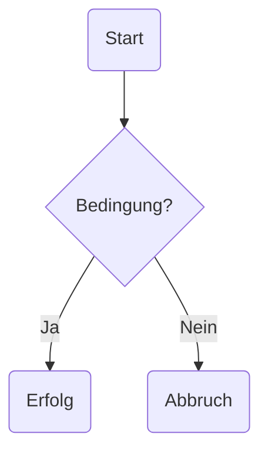

## Markdown-Test

Diese Seite testet die Markdown-Funktionen von **annication**.

## Inline-Formatierung

Normaler Text, **fetter Text**, *kursiver Text* und `inlineCode()`.

Ein Wikilink: [[Minimum]].

Ein Wikilink mit Anzeigename: [[Minimum|das hier führt zum Minimum]].

## Mathematische Formeln

Inline: $f(x) = x^2 + 1$.

Abgesetzt:

$$
\sum_{i=1}^{n} i = \frac{n(n+1)}{2}
$$

## Listen

- Erster Eintrag
- Zweiter Eintrag
    - Verschachtelter Eintrag
    - Noch ein Eintrag
        1. darin eine nummerierte Liste ...
        2. ... mit zwei Einträgen
- Dritter Eintrag

1. Erster Schritt
2. Zweiter Schritt
    - Erster Untereintrag
    - Zweiter Untereintrag
3. Dritter Schritt

## Tabellen

| Name | Formel | Wert |
|:-----|:------:|-----:|
| Quadrat | $x^2$ | 4 |
| Summe | $1+2$ | **3** |
| Funktion | `f(x)` | 7 |

## Codeblöcke

```python
def square(x):
    result = x * x

    return result
```

## Mermaid



## Bilder


## Definition mit mehreren Blöcken

> [!definition] Graph
> Ein **Graph** ist ein Paar $G = (V,E)$.
>
> Dabei bezeichnet:
>
> - $V$ die Knotenmenge
> - $E$ die Kantenmenge
>
> Beispiel:
>
> ```python
> vertices = {1, 2, 3}
> edges = {(1, 2), (2, 3)}
> ```

## Satz

> [!theorem] Handschlaglemma
> Für einen endlichen ungerichteten Graphen gilt:
>
> $$
> \sum_{v \in V} \deg(v) = 2|E|
> $$

## Beweis

> [!proof] Beweis
> Jede Kante trägt genau **zweimal** zur Summe der Knotengrade bei.
>
> Daher folgt die Behauptung.

## Ergänzungen

> [!question]- Was bedeutet das eigentlich?
> Mit Überschrift und verschlossen.

> [!question]+ Was bedeutet das eigentlich?
> Mit Überschrift und offen.

> [!question]
> Oder auch ohne Überschrift im Defaultmodus.

## Beispiel mit Tabelle

> [!example] Knotengrade
> Betrachte die folgende Tabelle:
>
> | Knoten | Grad |
> |:-------|-----:|
> | A | 2 |
> | B | 3 |
> | C | 1 |

## Beispiel mit Bild

> [!example] Rakete
> Die folgende Abbildung zeigt eine Rakete.
>
> 

## Zwischenstand

Wenn dieser Absatz korrekt dargestellt wird, hat der Renderer auch nach den komplexen Callouts normal weitergearbeitet.

## Wikilings in (inline-)Code

So funktioniert ein Wikilink: `[[Diesen Link kann man nicht anklicken ...]]`

```markdwon
[[... und den hier auch nicht.]]
```